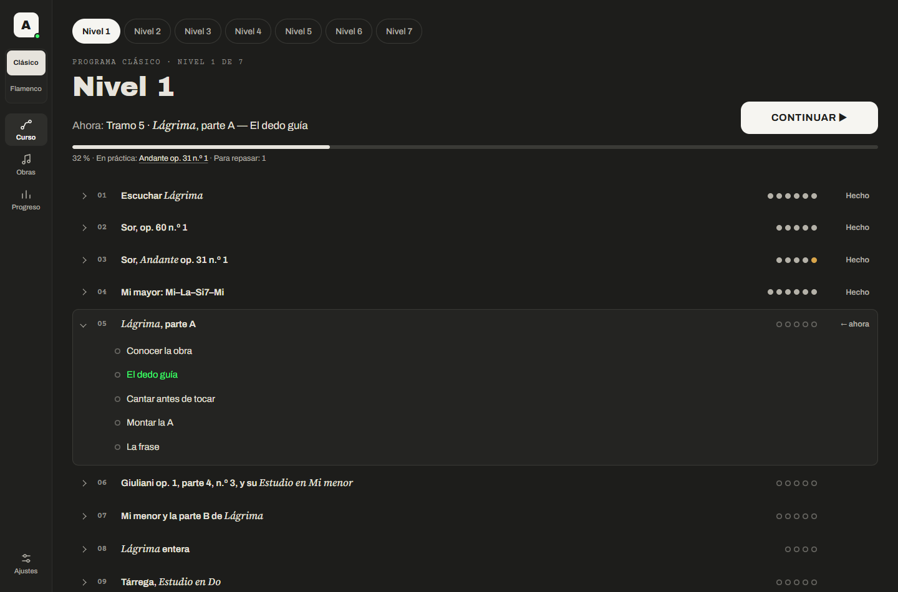
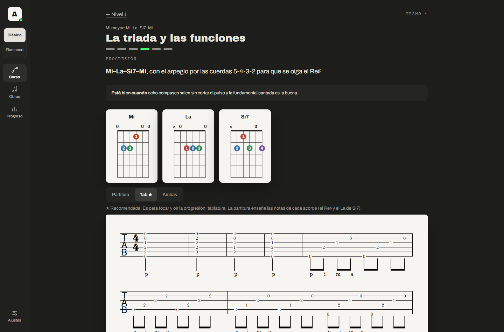
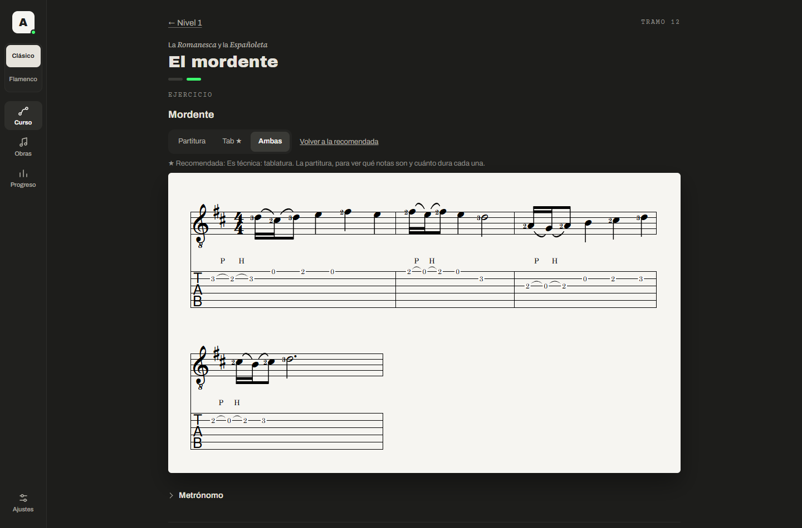

# Academia de guitarra

App local y personal para aprender guitarra clásica: Curso → Tramo → Lección → Paso, con un botón «Continuar». Funciona con Node 22 o superior y un navegador, sin dependencias.

**Rama de trabajo:** `revision-fase-2`. Los datos personales de práctica no están en este repositorio.

## Cómo se ve
Capturas reales de la app, con datos de prueba y un progreso de ejemplo. Cada enlace abre la imagen sin iniciar sesión.

- [Entrada al nivel](https://raw.githubusercontent.com/moran-lab-c/academia-guitarra/revision-fase-2/docs/capturas/01-entrada-nivel.png)
- [Nivel con «Continuar», tramos y lecciones](https://raw.githubusercontent.com/moran-lab-c/academia-guitarra/revision-fase-2/docs/capturas/02-nivel-continuar.png)
- [Progreso](https://raw.githubusercontent.com/moran-lab-c/academia-guitarra/revision-fase-2/docs/capturas/03-progreso.png)
- [Biblioteca de obras](https://raw.githubusercontent.com/moran-lab-c/academia-guitarra/revision-fase-2/docs/capturas/04-obras.png)
- [Página de una obra: *Lágrima*](https://raw.githubusercontent.com/moran-lab-c/academia-guitarra/revision-fase-2/docs/capturas/05-obra.png)
- [Paso con acordes y tablatura](https://raw.githubusercontent.com/moran-lab-c/academia-guitarra/revision-fase-2/docs/capturas/06-paso-acordes-y-tablatura.png)
- [Paso de ejercicio sin notación todavía](https://raw.githubusercontent.com/moran-lab-c/academia-guitarra/revision-fase-2/docs/capturas/07-paso-ejercicio.png)
- [Paso con partitura y tablatura](https://raw.githubusercontent.com/moran-lab-c/academia-guitarra/revision-fase-2/docs/capturas/08-paso-partitura-y-tablatura.png)
- [Paso de oído con preguntas](https://raw.githubusercontent.com/moran-lab-c/academia-guitarra/revision-fase-2/docs/capturas/09-paso-oido.png)
- [Paso con consejo del profesor](https://raw.githubusercontent.com/moran-lab-c/academia-guitarra/revision-fase-2/docs/capturas/10-paso-consejo-del-profesor.png)
- [Repaso](https://raw.githubusercontent.com/moran-lab-c/academia-guitarra/revision-fase-2/docs/capturas/11-repaso.png)
- [Otro nivel: Nivel 5](https://raw.githubusercontent.com/moran-lab-c/academia-guitarra/revision-fase-2/docs/capturas/12-nivel-5.png)

## El Tramo 4 del Nivel 1: el tramo de referencia
Aprobado el 30/10/2026 como estándar del curso. [Informe del Curso 1 enriquecido](https://raw.githubusercontent.com/moran-lab-c/academia-guitarra/revision-fase-2/docs/INFORME-CURSO-1.md). Las capturas son con datos de prueba; en las de página entera, la barra lateral aparece desplazada por cómo se hace la captura, no en la app.

- [Contenido del tramo, paso a paso](https://raw.githubusercontent.com/moran-lab-c/academia-guitarra/revision-fase-2/contenido/curriculo/enriquecido/n1-t4.json)
- [Auditoría de la versión anterior](https://raw.githubusercontent.com/moran-lab-c/academia-guitarra/revision-fase-2/docs/AUDITORIA-TRAMO-4.md)
- [Cómo funciona el sistema](https://raw.githubusercontent.com/moran-lab-c/academia-guitarra/revision-fase-2/docs/ENRIQUECIMIENTO.md)
- [El patrón de la escala mayor](https://raw.githubusercontent.com/moran-lab-c/academia-guitarra/revision-fase-2/docs/capturas/tramo-4/01-patron-escala-mayor.png)
- [Construir Mi mayor y sus sostenidos](https://raw.githubusercontent.com/moran-lab-c/academia-guitarra/revision-fase-2/docs/capturas/tramo-4/02-construir-mi-mayor.png)
- [Localizar notas en el diapasón](https://raw.githubusercontent.com/moran-lab-c/academia-guitarra/revision-fase-2/docs/capturas/tramo-4/03-localizar-en-el-diapason.png)
- [Los dedos de cada mano y p-i-m-a](https://raw.githubusercontent.com/moran-lab-c/academia-guitarra/revision-fase-2/docs/capturas/tramo-4/04-dedos-de-cada-mano.png)
- [Tablatura con digitación, mano derecha y pulso](https://raw.githubusercontent.com/moran-lab-c/academia-guitarra/revision-fase-2/docs/capturas/tramo-4/05-escala-tablatura-digitada.png)
- [La armadura y cómo cambia la lectura](https://raw.githubusercontent.com/moran-lab-c/academia-guitarra/revision-fase-2/docs/capturas/tramo-4/06-armadura-y-lectura.png)
- [Por qué una triada es mayor o menor](https://raw.githubusercontent.com/moran-lab-c/academia-guitarra/revision-fase-2/docs/capturas/tramo-4/07-triada-mayor-y-menor.png)
- [Un acorde construyéndose sobre el fondo oscuro](https://raw.githubusercontent.com/moran-lab-c/academia-guitarra/revision-fase-2/docs/capturas/tramo-4/08-acorde-construyendose.png)
- [Si7 completo, con su tabla](https://raw.githubusercontent.com/moran-lab-c/academia-guitarra/revision-fase-2/docs/capturas/tramo-4/09-acorde-si7-completo.png)
- [El tritono y su resolución](https://raw.githubusercontent.com/moran-lab-c/academia-guitarra/revision-fase-2/docs/capturas/tramo-4/10-tritono-y-resolucion.png)
- [La progresión, con un compás señalado desde el texto](https://raw.githubusercontent.com/moran-lab-c/academia-guitarra/revision-fase-2/docs/capturas/tramo-4/11-progresion-compas-senalado.png)
- [Qué significa p-i-m-a, con la mano derecha](https://raw.githubusercontent.com/moran-lab-c/academia-guitarra/revision-fase-2/docs/capturas/tramo-4/12-que-significa-pima.png)
- [El dedo común en un cambio de acorde](https://raw.githubusercontent.com/moran-lab-c/academia-guitarra/revision-fase-2/docs/capturas/tramo-4/13-dedo-comun.png)

## Para leerlo sin descargar nada
Todos estos enlaces son texto plano y se abren sin iniciar sesión.

**Empieza por aquí**
- [Contexto y reglas del proyecto](https://raw.githubusercontent.com/moran-lab-c/academia-guitarra/revision-fase-2/CLAUDE.md)
- [Estado de la implementación y lo que falta](https://raw.githubusercontent.com/moran-lab-c/academia-guitarra/revision-fase-2/docs/IMPLEMENTACION-V3.1.md)
- [Arquitectura del código](https://raw.githubusercontent.com/moran-lab-c/academia-guitarra/revision-fase-2/docs/Arquitectura%20de%20la%20academia.md)

**El currículo aprobado (V3.1), la fuente de verdad**
- [Currículo maestro](https://raw.githubusercontent.com/moran-lab-c/academia-guitarra/revision-fase-2/docs/curriculo/CURRICULO-MAESTRO.md)
- Niveles: [1](https://raw.githubusercontent.com/moran-lab-c/academia-guitarra/revision-fase-2/docs/curriculo/curso-1.md) · [2](https://raw.githubusercontent.com/moran-lab-c/academia-guitarra/revision-fase-2/docs/curriculo/curso-2.md) · [3](https://raw.githubusercontent.com/moran-lab-c/academia-guitarra/revision-fase-2/docs/curriculo/curso-3.md) · [4](https://raw.githubusercontent.com/moran-lab-c/academia-guitarra/revision-fase-2/docs/curriculo/curso-4.md) · [5](https://raw.githubusercontent.com/moran-lab-c/academia-guitarra/revision-fase-2/docs/curriculo/curso-5.md) · [6](https://raw.githubusercontent.com/moran-lab-c/academia-guitarra/revision-fase-2/docs/curriculo/curso-6.md) · [7](https://raw.githubusercontent.com/moran-lab-c/academia-guitarra/revision-fase-2/docs/curriculo/curso-7.md)
- [Repertorio](https://raw.githubusercontent.com/moran-lab-c/academia-guitarra/revision-fase-2/docs/curriculo/repertorio.md) · [Ejercicios](https://raw.githubusercontent.com/moran-lab-c/academia-guitarra/revision-fase-2/docs/curriculo/ejercicios.md) · [Cobertura](https://raw.githubusercontent.com/moran-lab-c/academia-guitarra/revision-fase-2/docs/curriculo/cobertura.md) · [Auditoría de la V3](https://raw.githubusercontent.com/moran-lab-c/academia-guitarra/revision-fase-2/docs/curriculo/AUDITORIA-V3.md)

**El código principal**
- [Lanzador: Abrir academia.cmd](https://raw.githubusercontent.com/moran-lab-c/academia-guitarra/revision-fase-2/Abrir%20academia.cmd)
- [Servidor](https://raw.githubusercontent.com/moran-lab-c/academia-guitarra/revision-fase-2/servidor/servidor.js)
- [Arranque de la interfaz](https://raw.githubusercontent.com/moran-lab-c/academia-guitarra/revision-fase-2/web/inicio.js)
- [Lógica de «Continuar»](https://raw.githubusercontent.com/moran-lab-c/academia-guitarra/revision-fase-2/logica/curriculo.js)
- [Pantalla del nivel](https://raw.githubusercontent.com/moran-lab-c/academia-guitarra/revision-fase-2/web/vistas/nivel.js) · [Pantalla del paso](https://raw.githubusercontent.com/moran-lab-c/academia-guitarra/revision-fase-2/web/vistas/aprender.js) · [Obras](https://raw.githubusercontent.com/moran-lab-c/academia-guitarra/revision-fase-2/web/vistas/obras.js)
- [Generador del currículo](https://raw.githubusercontent.com/moran-lab-c/academia-guitarra/revision-fase-2/herramientas/generar-curriculo.mjs)
- [Todos los archivos](https://github.com/moran-lab-c/academia-guitarra/tree/revision-fase-2)

## Cómo se abre
Doble clic en `Abrir academia.cmd`, o `npm start`. Pruebas: `npm test`. Las versiones anteriores del currículo están en `docs/curriculo/v1/` y `v2/`, solo como historial.
